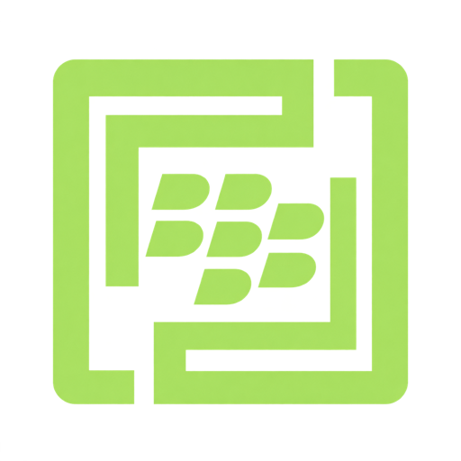
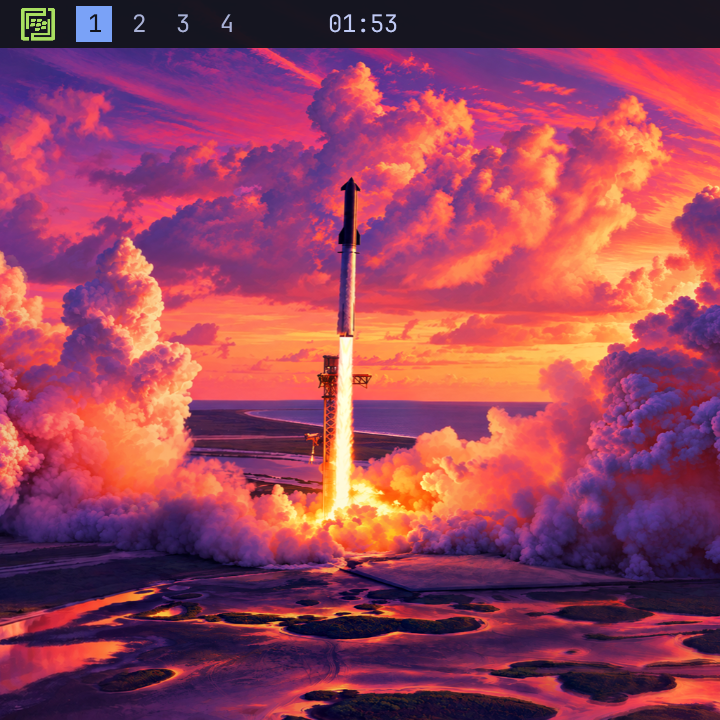
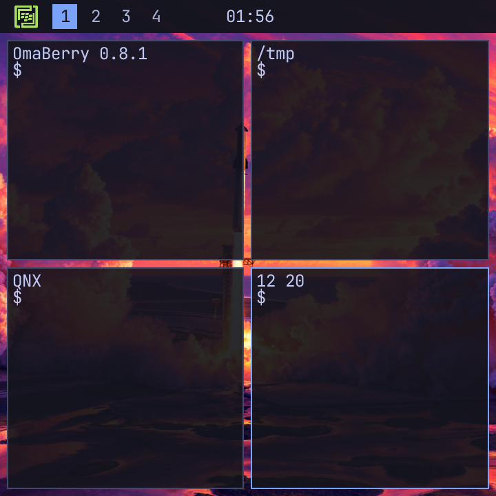

<div align="center">
  
  <h1>OmaBerry</h1>
  <p><strong>A native PocketJS tiling desktop for BlackBerry Classic / Q20.</strong></p>
  <p>BB10 / QNX · BerryCore shell · DeepSeek agents · Omarchy-inspired keyboard controls</p>
  <p>
    
    
    
    <a href="LICENSE"></a>
  </p>
  <p><a href="#desktop">Desktop</a> · <a href="#keyboard">Keyboard</a> · <a href="#build-and-install">Build</a> · <a href="native/README.md">Native development</a></p>
</div>

OmaBerry runs directly as a native BB10 application. PocketJS renders the desktop and connects it to QNX input, PTYs, files and processes through native bindings. **No browser, WebView, localhost web server or Node.js service is needed to run the desktop.**

OmaBerry 现已完全转向 **PocketJS 原生桌面**：在黑莓 Q20 上直接运行终端、文件管理、中文聊天和本地 agent 工具。左上角 OmaBerry logo 打开居中菜单；新窗口递归平铺，实体 Menu 键作为 Super 使用。

## Desktop

<p align="center">
  
  
</p>

Actual 720 × 720 Q20 framebuffer captures. The default wallpaper is **Liftoff Sunset**, the first artwork from Tokyo Liftoff.

| Feature | Available in the native app |
| --- | --- |
| Tiling desktop | Ten workspaces, up to sixteen windows, recursive half splits, focus/swap, resize, fullscreen and collapse on close |
| Terminal | Independent BerryCore PTY shells; working directories and running processes survive workspace switches |
| Files | Browse directories, filter names and read paginated text previews directly from the device |
| Chat | DeepSeek conversations, common simplified Chinese glyphs and an offline physical-keyboard Pinyin composer |
| Local agent tools | Execute shell commands, read/write files, inspect and change the live desktop |
| herdr adaptation | Sidebar showing the actual workspaces, shell windows and built-in agent task states |
| Notes | A scratchpad for each Notes window |
| Theme | Tokyo Night colors, thin focus borders, translucent panes and four Tokyo Liftoff wallpapers; wallpaper and style settings persist |

Each new window splits the focused pane in half along its longer dimension. Closing a pane lets its neighbor fill the freed area. The desktop has no window-manager titlebars or close buttons; click the top-left logo for the [centered menu](docs/native-menu.png), or use the keyboard.

## Keyboard

On the Q20, **hold the physical BlackBerry Menu key to use it as Super**. Tap and release Menu to open or dismiss the menu.

| Shortcut | Action |
| --- | --- |
| Super + Enter | Open a new terminal |
| Super + W / Q | Close the focused window |
| Super + Space | Open the centered OmaBerry menu |
| Super + Alt + Space | Applications |
| Super + arrows / Menu + trackpad | Focus a neighboring pane |
| Super + Shift + arrows | Swap panes |
| Super + J | Toggle the split direction |
| Super + F | Fullscreen / restore |
| Super + 1…9, 0 | Switch to workspace 1…10 |
| Super + Shift + number | Move the focused window to a workspace |
| Super + Shift + F / N / A | Files / Notes / agent chat |
| Super + Ctrl + Enter | Toggle the herdr sidebar |
| Super + K | Show shortcut help |

See the [full native shortcut map](docs/NATIVE-SHORTCUTS.md) for workspace cycling, resizing and theme controls. Ctrl chords require a suitable external keyboard; menu actions are also available.

## Native architecture

```text
Q20 keyboard / trackpad / touchscreen
                  │
       BB10 / QNX native host
       input · lifecycle · rendering
                  │
    PocketJS / QuickJS + native renderer
       TypeScript / Solid JSX desktop
                  │
          Native C bindings
     ┌────────────┼─────────────┐
     PTYs     files/processes  HTTPS child transport
     │            │             │
 BerryCore    local tools    DeepSeek API
```

The UI is written in TypeScript and Solid JSX and compiled for PocketJS's native renderer. There is no DOM or HTML/CSS page at runtime. Terminal and file operations use native APIs; DeepSeek requests use BerryCore's `curl` with certificate verification.

The built-in agent can use `run_shell`, `read_file`, `write_file` and `desktop`. Commands run with the app's permissions and return their actual output and exit status. The desktop tool can open/focus/close panes, change workspaces and splits, and adjust supported theme settings. Stop cancels an active request and its command process.

API credentials are provisioned separately in private application data. They are not included in the source, UI assets or BAR. Chat and tool results needed for a task are sent to the configured DeepSeek service; the desktop, terminal and file browser work without an AI connection.

## Build and install

This is a development build for a BB10 device with BerryCore installed. The build has been exercised on macOS with Bun, Python 3, Git, Rust and Docker. PocketJS and the BBNDK container are pinned.

```sh
git clone https://github.com/EazyLee30/omaberry.git
cd omaberry
python3 scripts/native.py prepare
```

Follow the [toolchain setup and device installation guide](native/README.md#build) before the first build, then run:

```sh
python3 scripts/native.py build
```

Outputs:

- `out/native/pocketjs-blackberry-classic-hero.bar` — native BB10 application.
- `out/native/build-receipt.json` — build identity and artifact hashes.

The filename and package ID retain the PocketJS development identity so existing app data survives updates. The installed application is named **OmaBerry** and uses the green OmaBerry icon. Install the BAR with a working BB10 deployment path, allow Shared Files when prompted, and launch it from its phone icon.

See [native development](native/README.md) for private DeepSeek configuration, source layout, build prerequisites and checks. No browser installation step is involved.

## Current limits

This is an independently implemented native adaptation of Omarchy and herdr, with further parity work ahead.

- Window layouts, shell sessions, Notes and chat history last for the app process lifetime. Wallpaper and desktop style persist across launches.
- The terminal handles a basic monochrome VT subset. Full terminal emulation, scrollback browsing and arbitrary full-screen terminal programs are not yet covered.
- The built-in Pinyin composer is available in Chat. It does not switch the BB10 system input method.
- One built-in agent task runs at a time. Upstream herdr's daemon, detached CLI/socket protocol, SSH host orchestration and external-agent detection are not implemented.
- Agents can change the supported live desktop state. Hot rebuilding native JSX and resource packs from inside the app is still future work.
- The app runs within BB10; it does not install Hyprland or replace the phone OS.

The older `web/`, `server/`, `sim/` and browser packaging scripts are retained as historical source. They are outside the active native runtime and build path. Development now targets `native/` and `scripts/native.py`.

## Credits

- [PocketJS](https://github.com/pocket-nexus/pocketjs) — native runtime and compiler, pinned to `3d0983769f62ac75bacd62b723c15202425b2dd1`.
- [Omarchy](https://github.com/omacom/omarchy) and [Omarchy Mobile](https://github.com/derekross/omarchy-mobile) — keyboard, menu, tiling and visual references.
- [herdr](https://github.com/herdrdev/herdr) — workspace and agent interface reference.
- [Tokyo Liftoff](https://github.com/tcballard/omarchy-theme-tokyo-liftoff) — theme and wallpaper artwork. See the retained [artwork credits](native/src/Tokyo-Liftoff-CREDITS.txt) and [theme license](native/src/Tokyo-Liftoff-LICENSE.txt).
- Noto Sans SC — common Chinese glyphs, under the included [SIL Open Font License](native/src/OFL-NotoSansSC.txt).
- BerryCore — the device's shell tools and HTTPS transport.

The [OmaBerry logo](docs/logo.png) is the project owner's supplied artwork, used consistently in the native top bar, menu, application icon and this README. [Brand asset details](docs/BRANDING.md).

OmaBerry code is [MIT licensed](LICENSE). Third-party assets retain their own licenses and source attributions. Implementation and device verification history is recorded in [NATIVE-MIGRATION.md](docs/NATIVE-MIGRATION.md).
