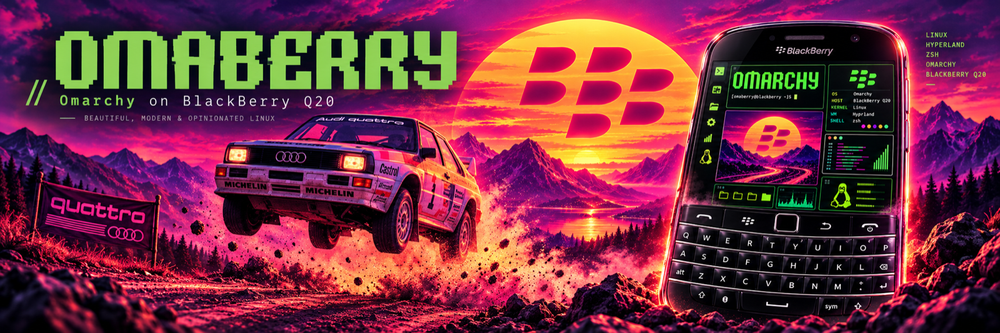

<div align="center">

  

  <br>

  

  <h1>OmaBerry</h1>
  <h3>Omarchy on BlackBerry Q20 — a beautiful, modern &amp; opinionated Linux desktop for the keyboard.</h3>

  <p>
    <a href="https://github.com/EazyLee30/omaberry"></a>
    <a href="https://github.com/EazyLee30/omaberry"></a>
    <a href="https://github.com/EazyLee30/omaberry"></a>
    <a href="https://github.com/EazyLee30/omaberry"></a>
  </p>
  <p>
    <a href="https://github.com/EazyLee30/omaberry/stargazers"></a>
    <a href="https://github.com/EazyLee30/omaberry/network/members"></a>
    <a href="https://github.com/EazyLee30/omaberry/commits/main"></a>
    <a href="LICENSE"></a>
    <a href="https://github.com/EazyLee30/omaberry/releases"></a>
  </p>

  <p>
    <a href="#highlights">✦ Highlights</a> ·
    <a href="#architecture">⬢ Architecture</a> ·
    <a href="#quick-start">⚡ Quick Start</a> ·
    <a href="#q20-input-map">⌨ Key Map</a> ·
    <a href="#roadmap">◈ Roadmap</a> ·
    <a href="#credits">❖ Credits</a>
  </p>

</div>

---

> **Not a Linux port. Not a theme.** OmaBerry is a real desktop shell that runs native
> BerryCore commands, manages workspaces, and puts the Q20's physical keyboard at the
> centre of every interaction.

<div align="center">
  
</div>

## Highlights

<table>
<tr>
<td width="50%" valign="top">

**◈ Desktop shell**
720×720 status bar, four workspaces, tiling launcher — built for the square screen, not scaled down.

**⌨ Keyboard-first**
Every action reachable from the physical QWERTY, trackpad and hardware keys. No touch required.

**▶ Native terminal**
A real PTY bridge into the BerryCore shell — not a JavaScript terminal emulator.

</td>
<td width="50%" valign="top">

**◱ File manager**
Browse, read and edit files straight on the device, sandboxed by the server-side FS API.

**✦ Omarchy visual language**
Dark theme, monospace type, minimal chrome, gap-tiled windows, green accents.

**◐ Offline-first &amp; recoverable**
Core desktop works with no network. Install / upgrade / uninstall freely — the BB10 kernel is never touched.

</td>
</tr>
</table>

## Architecture

```
┌─────────────────────────────────────┐
│         BlackBerry Q20 Hardware     │
│   QWERTY · Trackpad · Touch · Keys │
├─────────────────────────────────────┤
│         BB10 / QNX Kernel           │
├─────────────────────────────────────┤
│         BerryCore                   │
│   Node.js 22 · Git · SSH · qpkg    │
├─────────────────────────────────────┤
│         OmaBerry Server (Node)      │
│   WebSocket · PTY · FS · SysInfo   │
├─────────────────────────────────────┤
│         Berry Browser (Chromium 120)│
│   OmaBerry Desktop Shell           │
│   ┌───────────────────────────────┐ │
│   │ StatusBar · Workspaces · Dock │ │
│   │ Launcher · Terminal · Files   │ │
│   │ Keyboard Handler · Gestures   │ │
│   └───────────────────────────────┘ │
└─────────────────────────────────────┘
```

| Layer | Role |
| --- | --- |
| **BerryCore** | Unix-like shell environment: Node.js 22, Git, SSH, package manager |
| **OmaBerry Server** | HTTP + WebSocket daemon bridging PTY, file system and system info |
| **Desktop shell** | Pure vanilla JS/CSS UI running inside Berry Browser |

## Quick Start

### 1 · Prerequisites — on Q20, with BerryCore installed

```sh
qpkg install node-term49
node --version   # must be v22.x
```

### 2 · Install — from your computer

```sh
git clone https://github.com/EazyLee30/omaberry.git
scp -r omaberry bb10:/accounts/1000/shared/misc/omaberry
ssh bb10 'sh /accounts/1000/shared/misc/omaberry/scripts/install.sh'
```

### 3 · Launch — in Term49 or over SSH

```sh
omaberry
```

Then open **Berry Browser** → `http://127.0.0.1:9820`

<div align="center">
  <sub>Uninstall any time with <code>scripts/uninstall.sh</code> — nothing outside the OmaBerry directory is modified.</sub>
</div>

## Q20 Input Map

Every physical input on the device is mapped:

| Input | Desktop | Terminal | Launcher |
| --- | --- | --- | --- |
| <kbd>Alt</kbd>+<kbd>T</kbd> | Open terminal | — | — |
| <kbd>Alt</kbd>+<kbd>L</kbd> | Open launcher | Exit → Launcher | — |
| <kbd>Alt</kbd>+<kbd>F</kbd> | Open files | Exit → Files | — |
| <kbd>Alt</kbd>+<kbd>1</kbd>–<kbd>4</kbd> | Switch workspace | Switch workspace | — |
| <kbd>Alt</kbd>+<kbd>Q</kbd> | Close window | Close tab | Close |
| <kbd>Alt</kbd>+<kbd>Enter</kbd> | Toggle fullscreen | Toggle fullscreen | Launch |
| <kbd>Alt</kbd>+<kbd>Space</kbd> | Command palette | — | — |
| <kbd>Alt</kbd>+<kbd>H</kbd><kbd>J</kbd><kbd>K</kbd><kbd>L</kbd> | Focus ← ↓ ↑ → | — | — |
| Trackpad | Cursor / scroll | Scroll buffer | Navigate items |
| Trackpad click | Select | — | Launch selected |
| Back key | Close overlay | Unfocus terminal | Close launcher |
| Menu key | Context menu | Terminal menu | — |
| Type anything | — | Input to shell | Filter search |
| Swipe ← from right | Quick settings | — | — |
| Swipe → from left | Show launcher | — | — |

Full mapping lives in [`web/js/keys.js`](web/js/keys.js), with an interactive
test page at [`test/test-keys.html`](test/test-keys.html).

## Project Structure

```
omaberry/
├── server/
│   ├── index.js            Main server (HTTP + WebSocket)
│   ├── pty-bridge.js       Terminal PTY bridge
│   ├── fs-api.js           Sandboxed file system API
│   └── sys-api.js          System information
├── web/
│   ├── index.html          Desktop shell
│   ├── assets/             Wallpapers & icons
│   ├── css/
│   │   ├── tokens.css      Omarchy design tokens
│   │   ├── desktop.css     Desktop layout
│   │   ├── terminal.css    Terminal styles
│   │   └── launcher.css    Launcher styles
│   └── js/
│       ├── kernel.js       Event bus & state management
│       ├── keys.js         Keyboard, trackpad & gesture handler
│       ├── desktop.js      Desktop shell controller
│       ├── statusbar.js    Status bar (clock, battery, wifi)
│       ├── workspace.js    Workspace manager (4 virtual desktops)
│       ├── launcher.js     App launcher with search
│       ├── terminal.js     Terminal renderer
│       └── filemanager.js  File browser
├── scripts/
│   ├── install.sh          Install to BerryCore
│   ├── uninstall.sh        Clean removal
│   └── preflight.sh        Pre-flight system checks
├── test/
│   ├── test-keys.html      Interactive keyboard test page
│   └── test-server.js      Server unit tests
├── docs/                   Banner & icon artwork
└── out/                    Built *.bar packages (git-ignored)
```

## Design Language

Derived from Omarchy's visual system, adapted for a 720×720 square screen:

| Token | Value | Usage |
| --- | --- | --- |
| Background | `#0d1117` → `#161b22` | Desktop gradient |
| Surface | `#21262d`, border `#30363d` | Windows, panels |
| Accent | `#a3ff12` / `#58a6ff` / `#ff2d95` | Focus, links, highlights |
| Type | JetBrainsMono Nerd Font → monospace fallback | All UI text |
| Chrome | None | No window decorations, 8px radius, 4px gaps |
| Bar | 28px translucent | Status bar at the top |

## What it is *not*

- Not Arch Linux, and not official Omarchy
- Not a Linux kernel replacement for BB10
- Not Hyprland / Wayland / X11
- Does not replace the BB10 home screen at OS level
- Does not require reflashing, bootloader changes or root

## Roadmap

- [x] Desktop shell, status bar, workspaces, launcher
- [x] Native PTY terminal on BerryCore
- [x] File manager with sandboxed FS API
- [x] Full Q20 keyboard, trackpad & gesture map
- [x] QNX `pathtrust` registration so the binary runs untrusted
- [ ] Agent hub — connect external AI agents over SSH / API
- [ ] Themable accent colours & wallpaper picker
- [ ] Bluetooth keyboard & external display support
- [ ] Signed `.bar` release channel

## Credits

OmaBerry would not exist without the work of these projects and people:

| Project | What it gives us |
| --- | --- |
| [Omarchy](https://github.com/omaranstudio/omarchy) | The design language and the idea of an opinionated Linux desktop |
| [BerryCore](https://github.com/sw7ft/BerryCore) | The Unix-like shell environment running on BB10 |
| [reberry](https://github.com/EazyLee30/reberry) | Q20 recovery, BerryCore setup and device bring-up |
| [berrybrowser-cjk](https://github.com/EazyLee30/berrybrowser-cjk) | CJK font patch for Berry Browser |
| [berrycode](../tree/main/berrycode) | ChatGPT + Codex on BB10 |

## License

<div align="center">

**MIT** © 2026 Eazy Lee — see [LICENSE](LICENSE).

BlackBerry, BB10, QNX and Q20 are trademarks of their respective owners.
OmaBerry is an independent community project, not affiliated with BlackBerry Limited.
Omarchy design language used with attribution to Oman Studio.

<br>

<a href="https://github.com/EazyLee30/omaberry"></a>

<sub>Built for the keyboard. The desktop returns.</sub>

</div>